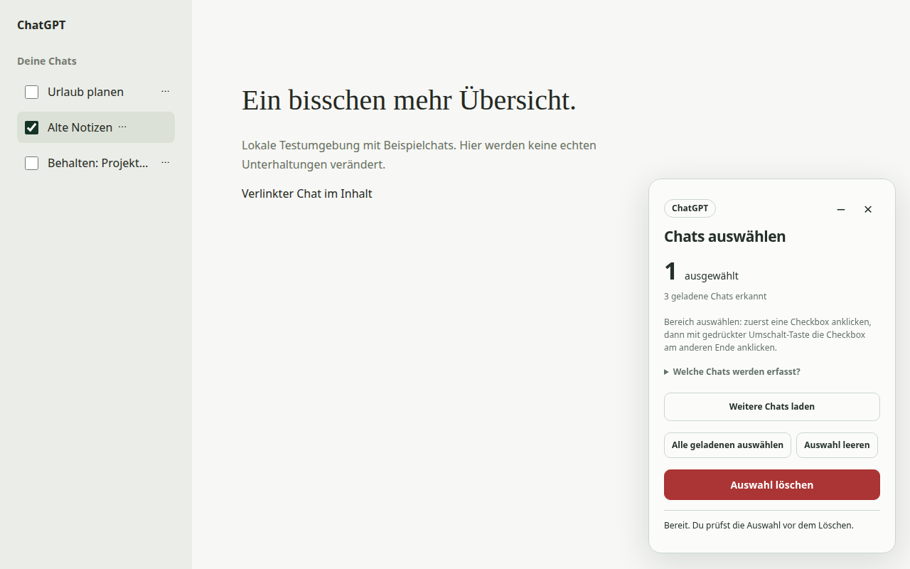

# AI Chat-Auswahl

Chrome-Erweiterung zum Auswählen und gemeinsamen Löschen von Chats bei **ChatGPT,
Claude und Gemini**. Version **1.3.0**, erste öffentliche Beta.

Die Erweiterung ergänzt Checkboxen in der Verlaufsseitenleiste. Vor dem Löschen
prüfst du die vollständige Auswahl. Auch Codex-Aufgaben im ChatGPT-Verlauf sind
auswählbar und in der Vorschau gekennzeichnet.



Die Abbildung zeigt die Erweiterung auf einer lokalen Testseite, keine echten Kontodaten.

**Während des Löschens den Tab geöffnet lassen. Nicht neu laden und nicht zu
einer anderen Seite wechseln, bis der Vorgang beendet ist.**

Löschen ist endgültig und betrifft dein Konto. Bei Gemini umfasst es auch
zugehörige Aktivitäten und im Chat erstellte Inhalte wie Canvas-Dokumente.
Die Erweiterung hält bei uneindeutigen IDs, Menüs oder Dialogen an.

## Installation

1. [AI Chat-Auswahl 1.3.0 herunterladen](https://github.com/PierreSp/ai-chat-auswahl/releases/download/v1.3.0/ai-chat-auswahl-1.3.0.zip) und entpacken.
2. In Chrome `chrome://extensions` öffnen und **Entwicklermodus** einschalten.
3. **Entpackte Erweiterung laden** wählen und den Ordner `ai-chat-auswahl` mit
   `manifest.json` auswählen. Diesen Ordner anschließend an seinem Platz lassen.
4. ChatGPT, Claude oder Gemini neu laden und **Chats aufräumen** öffnen.

Alternativ dieses Repository klonen und dessen Ordner laden. Node.js und npm
sind für die Benutzung nicht erforderlich. Eine Chrome-Web-Store-Version ist
noch nicht veröffentlicht.

Bei Updates die Dateien im bestehenden Erweiterungsordner ersetzen, die
Erweiterung auf `chrome://extensions` neu laden und danach die betroffenen
Webseiten neu laden. Nicht während eines laufenden Löschvorgangs aktualisieren.

## Benutzung

- Chats links ankreuzen. Für einen Bereich zuerst eine Checkbox normal anklicken,
  anschließend **Umschalt** halten und die Checkbox am anderen Ende anklicken.
  Ihr neuer Zustand gilt für den ganzen Bereich; bestehende Markierungen
  außerhalb bleiben erhalten. Bei Bedarf vorher **Auswahl leeren** verwenden.
- **Weitere Chats laden** scrollt die erkannte Seitenleiste begrenzt weiter.
  Neue Einträge bleiben abgewählt. Manuelles Scrollen funktioniert ebenfalls.
- **Auswahl löschen** öffnet die Vorschau. Einzelne Einträge lassen sich dort
  entfernen. Nach der Prüfung das Bestätigungsfeld anhaken und Löschen starten.
- Den Tab bis zum Ende geöffnet lassen. **Anhalten** oder **Escape** stoppt
  weitere Löschungen; eine bereits bestätigte Löschung kann noch fertig werden.
- Bei einem Abbruch den Verlauf prüfen, bevor du eine neue Auswahl bestätigst.

Geladene Einträge außerhalb des Bildschirms erhalten ebenfalls Checkboxen.
Eingeklappte Gruppen musst du selbst öffnen. Geschlossene Projekte, Archive und
Suchergebnisse werden nicht durchsucht. Eine geladene Auswahl ist keine
vollständige Übersicht aller Chats im Konto.

## Datenschutz und Grenzen

Die Erweiterung arbeitet lokal über die Oberfläche der drei Websites. Keine
eigenen Netzwerkanfragen, API-Schlüssel, Telemetrie oder Diagnoseexporte. Auswahl
und Fortschritt liegen nur im Arbeitsspeicher des Tabs. Details: [Datenschutz](PRIVACY.md).

Änderungen an den Websites können Anpassungen erforderlich machen. Die Erkennung
unterstützt bekannte Oberflächen und Dialogvarianten, nicht jede mögliche Sprache
oder Kontovariante. Die automatische Testsuite verwendet künstliche Chats.
Live wurden Menüs und Dialoge untersucht und abgebrochen; produktive Löschungen
wurden vom Benutzer erprobt. Eine vollständige Live-Testmatrix über alle Dienste
und Sprachen liegt nicht vor.

Probleme können über [GitHub Issues](https://github.com/PierreSp/ai-chat-auswahl/issues)
gemeldet werden. Bitte Dienst, Erweiterungsversion und Fehlermeldung angeben;
private Chat-Titel und Kontodaten vor dem Veröffentlichen entfernen.

## Entwicklung und Tests

Voraussetzung: Node.js 20 oder neuer.

```sh
npm ci
npx playwright install chromium
npm test
```

Die Browsertests laufen in einem neuen temporären Profil. Anfragen an die drei
Dienste werden durch lokale Testseiten ersetzt; andere Anfragen werden blockiert.
Sie löschen keine echten Kontodaten. Optional können `PLAYWRIGHT_MODULE` und
`CHROMIUM_PATH` vorhandene Installationen angeben.

Für das Release-Archiv wird zusätzlich Python 3 benötigt:

```sh
npm run package
```

Das erzeugt `dist/ai-chat-auswahl-1.3.0.zip` und eine SHA-256-Prüfsumme. Das Archiv
enthält den direkt ausführbaren Erweiterungsquellcode, Bedienung und Lizenz.
Entwicklungswerkzeuge, Testdaten und Git-Verlauf werden nicht mitgepackt.
Zusätzlich entsteht `dist/ai-chat-auswahl-1.3.0-webstore.zip` mit `manifest.json`
direkt im Archivwurzelverzeichnis für den Store-Upload. Die
[Store-Vorbereitung](docs/chrome-web-store.md) beschreibt die noch offenen Schritte.
Hinweise zur [Erkennungsbasis](docs/recognition-sources.txt) liegen im Repository.

## Lizenz

Copyright (C) 2026 Pierre Springer. Freie Software unter der **GNU General Public
License, Version 3 (GPL-3.0-only)**. Der vollständige Lizenztext steht in [LICENSE](LICENSE).
Das Programm wird ohne Gewährleistung bereitgestellt.

[Änderungen](CHANGELOG.md) · [Ausführliche Bedienung](README.txt)

Unabhängiges Hilfsprogramm; kein offizielles Produkt von OpenAI, Anthropic oder Google.
