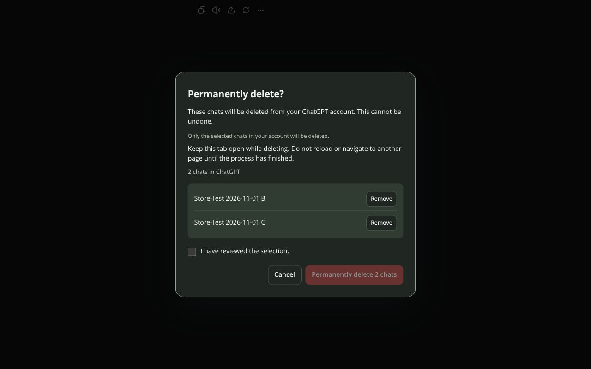

# ChatSweep

**Fewer chats. More clarity.**

Select, review and bulk delete conversations in ChatGPT, Claude and Gemini.
ChatSweep adds checkboxes to your chat history so you can clean up several
conversations in one go. Codex tasks in ChatGPT's history are supported too.

**Version 1.4.1 · Public beta · GPL-3.0**

Previously called AI Chat-Auswahl. [Deutsche Anleitung](README.de.md).



Real extension screenshot, showing only chats created for testing.

## Install

1. [Download ChatSweep 1.4.1](https://github.com/PierreSp/ai-chat-auswahl/releases/download/v1.4.1/chatsweep-1.4.1.zip) and unzip it.
2. Open `chrome://extensions` in Chrome and enable **Developer mode**.
3. Choose **Load unpacked** and select the `chatsweep` folder containing `manifest.json`.
4. Keep that folder in place. Reload the supported websites and open **Clean up chats**.

No Node.js, npm, API key or separate account is needed to use the extension.
Chrome Web Store submission materials are prepared; the extension is not yet
listed in the Store.

To update, replace the files in your existing extension folder, reload the
extension on `chrome://extensions`, then reload the supported tabs. Do not update
while deletion is running.

## How it works

- Select individual chats, or click one checkbox and **Shift-click** the checkbox
  at the other end of a range. Existing selections outside the range remain unchanged.
- **Load more chats** scrolls the loaded history. New entries stay unselected.
- **Delete selection** opens a review of every selected item. Remove anything you
  want to keep, then confirm the reviewed selection.
- **Keep the tab open while deletion runs. Do not reload or navigate away.**
- **Stop** or **Escape** prevents further deletions. A deletion already confirmed
  may still finish. Check your history after a stop or error.

Deletion is permanent and affects your account. On Gemini it also includes
associated activity and content created in that chat, such as Canvas documents.

The interface follows Chrome's language: German is available, with English as
the default and fallback for other languages. Support for the websites' own
native confirmation dialogs is separate and covers known variants, not every language.

## Scope and privacy

Loaded entries outside the visible screen can be selected. Collapsed groups must
be opened manually. Closed projects, archives and search results are not searched.
A loaded list is not a complete inventory of all chats in your account.

ChatSweep uses the websites' existing menus and confirmation dialogs. It stops
when identifiers, menus or confirmation details cannot be matched reliably.
Changes to a provider's interface can require an update.

Chat titles, identifiers and controls are processed locally in the tab. No
analytics, diagnostic exports, developer servers or extension-originated network
requests. Selection and progress are held in memory and disappear when the tab
closes or reloads. The websites make their usual requests in response to the
confirmed actions. [Privacy policy](PRIVACY.md) · [Datenschutz](PRIVACY.de.md).

## Development

Node.js 20 or newer:

```sh
npm ci
npx playwright install chromium
npm test
```

Automated browser tests use a fresh temporary profile and synthetic local pages.
Requests to supported providers are intercepted; all other requests are blocked.
The suite never deletes real account data. `PLAYWRIGHT_MODULE` and `CHROMIUM_PATH`
can point to existing installations.

To create the distribution archives, also install Python 3 and run:

```sh
npm run package
```

`dist/chatsweep-1.4.1.zip` is for manual installation;
`dist/chatsweep-1.4.1-webstore.zip` has its manifest at the archive root for Store
submission. Each has a SHA-256 checksum. Both contain the same readable extension
sources, icons, translations, license and user documentation. Development tools
and test data are excluded.

[Live test report](store/live-test-report.md) · [Store preparation](docs/chrome-web-store.md) · [Changes](CHANGELOG.md) ·
[Recognition sources](docs/recognition-sources.txt)

## Support and license

Report problems in [GitHub Issues](https://github.com/PierreSp/ai-chat-auswahl/issues).
Include the provider, extension version and error message. Remove private titles,
account details and chat content before posting.

Copyright (C) 2026 Pierre Springer. Licensed under the
[GNU General Public License v3.0 only](LICENSE). Provided without warranty.

Independent software; not an official product of OpenAI, Anthropic or Google.
